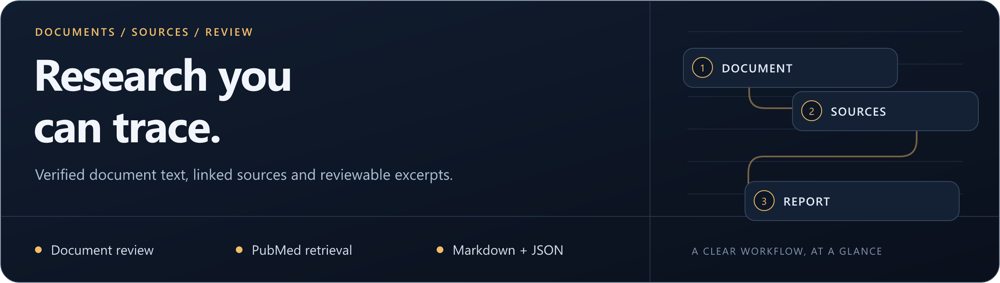

# MedResearch

<p align="center">
  
</p>

**A review-first workspace for medical documents and PubMed research.**

Python **3.11+** · Windows / Linux / macOS · CLI + local API · [MIT](LICENSE)

[](https://github.com/rvnsre/medresearch-cli/actions/workflows/ci.yml)

[Quick start](#quick-start) · [Review workflow](#review-workflow) · [Platforms](#platforms-and-requirements) · [Documentation](#documentation)

> **Project status:** Research-support preview, not clinically validated software. No autonomous diagnosis, prescribing or treatment decisions. [Validation and limits](VALIDATION.md).

## From documents to traceable research

Bring verified document text, retrieved abstracts and source-linked excerpts into a Markdown/JSON research packet. Searches are previewed before transmission; external AI requires a **separate second approval**.

| Review documents | Retrieve sources | Export evidence |
| --- | --- | --- |
| TXT, text/scanned PDFs and JPEG/PNG report photos; optional local Tesseract OCR. | PubMed search, PMID/DOI deduplication, abstracts and per-case caching. | Reviewed source text, study metadata and validated excerpt pairs in Markdown or JSON. |

Choose **no AI**, local **Ollama**, or a compatible external HTTPS provider. Source-only mode does not claim to assess findings or contradictions. OCR supports requested Azerbaijani, Russian and English language packs when installed.

## Review workflow

```text
Import → Review/correct pages → Preview search → Approve retrieval → Export
                                                            |
                      External AI only: preview payload → approve again
```

Every accepted AI relationship carries an exact document quote/page reference and exact abstract quote/PMID. Potential contradictions are paired excerpts for review, not confirmed clinical inconsistencies.

## Quick start

```bash
git clone https://github.com/rvnsre/medresearch-cli.git
cd medresearch-cli
```

<details open>
<summary><strong>Windows / PowerShell</strong></summary>

```powershell
py -3.11 -m venv .venv
..venvScriptspython.exe -m pip install -c requirements-verified.txt -e ".[dev]"
..venvScriptsmedresearch.exe doctor
```

</details>

<details>
<summary><strong>Linux / macOS</strong></summary>

```bash
python3 -m venv .venv
.venv/bin/python -m pip install -c requirements-verified.txt -e '.[dev]'
.venv/bin/medresearch doctor
```

</details>

The direct venv executable avoids shell-activation differences. Tesseract is required only for OCR; a model is optional. See [OCR and model configuration](docs/OPERATIONS.md#install-on-windows) for language packs and endpoint checks.

### First run: use the synthetic fixture

The [complete CLI walkthrough](docs/OPERATIONS.md#cli-walkthrough) creates a case, imports [`examples/synthetic-report.txt`](examples/synthetic-report.txt), reviews page text and prepares a `--provider none` search preview. Inspect the exact query and destination before approving retrieval. Keep cases and exports outside the public checkout.

For a local API, generate a bearer token and start `medresearch serve`. All endpoints, including health and OpenAPI, require that token. [API startup and routes →](docs/OPERATIONS.md#api)

## Platforms and requirements

| Requirement | Notes |
| --- | --- |
| Python | 3.11 or newer. CI is configured for 3.11/3.12 on all three operating systems. |
| OCR | Tesseract plus the requested `aze`, `rus`, `eng` trained-data files. All recognized text needs review. |
| Local AI | Optional Ollama with an installed, verifiably local model and sufficient context capacity. |
| External AI | Optional HTTPS chat-completions provider; the exact outbound payload needs its own approval. |
| Interface | CLI and authenticated loopback API; no browser dashboard. |

Private data defaults to `%LOCALAPPDATA%/MedResearch` on Windows, `~/Library/Application Support/MedResearch` on macOS, and `$XDG_DATA_HOME/MedResearch` or `~/.local/share/MedResearch` on Linux. Override with `MEDRESEARCH_DATA_DIR`.

## Read the output correctly

- Retrieved material is **abstracts and metadata**, not downloaded full texts or a systematic review.
- Exact quotes establish provenance, not clinical truth, relevance, completeness or evidence quality.
- Masking can miss identifiers or alter relevant dates; it does not certify anonymity.
- Empty validated output does not establish absence of disease or conflicting evidence.
- The API owns its workspace while serving; use the API rather than opening the same workspace concurrently with the CLI.

Current input limits include **20 MiB per upload**, **100 PDF pages**, **30 megapixels per rendered image**, **200,000 extracted characters per document/case**, and **1–50 papers per search**. [Full limits and recovery behavior →](docs/OPERATIONS.md)

## Documentation

| Task | Guide |
| --- | --- |
| Configure OCR, local AI or external AI | [Installation and configuration](docs/OPERATIONS.md#windows-linux-and-macos) |
| Import, review, retrieve and export | [CLI walkthrough](docs/OPERATIONS.md#cli-walkthrough) |
| Understand the two approval stages | [External AI approvals](docs/OPERATIONS.md#external-ai-two-separate-approvals) |
| Integrate the local API | [Routes and authentication](docs/OPERATIONS.md#api) · [OpenAPI schema](docs/openapi.json) |
| Assess verification and provenance | [Validation](VALIDATION.md) · [Report interpretation](docs/OPERATIONS.md#report-interpretation) · [Audit](AUDIT.md) |
| Handle private data | [Security](SECURITY.md) · [License](LICENSE) |

[Report a software issue](https://github.com/rvnsre/medresearch-cli/issues/new) using synthetic fixtures and redacted diagnostics. Never include real patient documents, identifiers or private report exports.

---

**More from rvnsre:** [Extreme Autopilot](https://github.com/rvnsre/extreme-autopilot) · [ForgeFlow CLI](https://github.com/rvnsre/forgeflow-cli) · [LocalDesk Agent](https://github.com/rvnsre/localdesk-agent)
